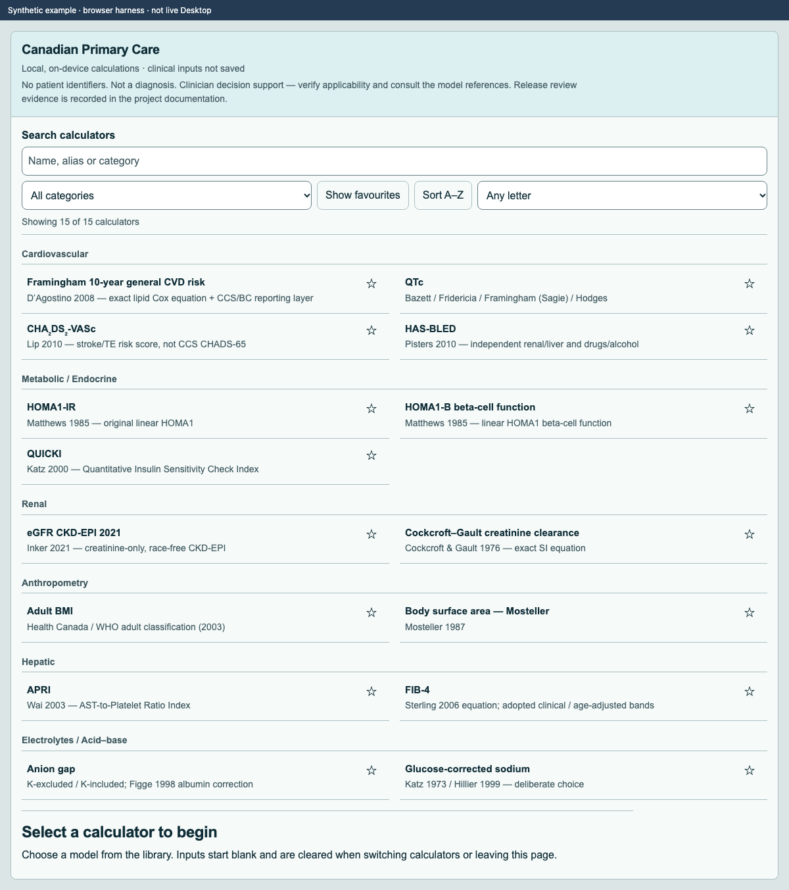
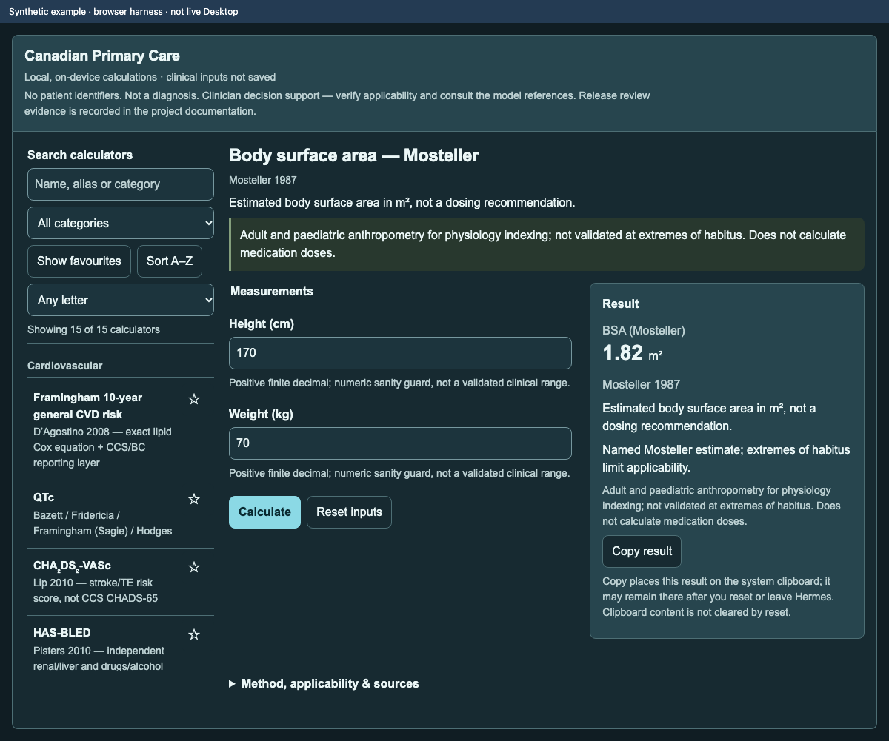
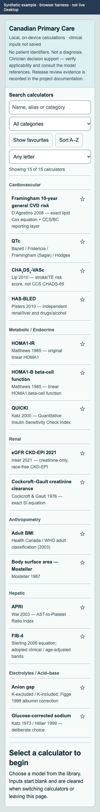

# Canadian Primary Care — Precision Console

**Version 0.3.0 · preview / prerelease.** Fifteen named calculators in six categories, using Canadian units, for Hermes Desktop. This is a fixed clinician-decision-support library, not a universal calculator or treatment recommendation.

## Disclaimer

**Disclaimer.** This software is provided for educational and clinician-decision-support purposes. **No claim of regulatory approval, clearance, or licensing is made, and no regulatory classification is asserted** — this software has **not** been reviewed, approved, cleared, or licensed by Health Canada, the FDA, or any other regulatory authority, and the absence of such a determination does not by itself establish device or non-device status. It does **not** diagnose, treat, or prescribe, and it is **not** a substitute for the judgment of a qualified clinician. Synthetic or example data appear **only in documentation, screenshots, and test vectors**; in actual use a clinician may enter real patient measurements, and the plugin stores **no** clinical values. (Redistribution/licence terms are documented separately and are not a grant of regulatory approval.)

## Included

- **Cardiovascular:** Framingham 10-year general CVD risk; QTc (Bazett, Fridericia, Framingham/Sagie, Hodges); CHA₂DS₂-VASc; HAS-BLED.
- **Metabolic / Endocrine:** HOMA1-IR; HOMA1-B; QUICKI.
- **Renal:** race-free creatinine CKD-EPI 2021 eGFR; Cockcroft–Gault creatinine clearance.
- **Hepatic:** FIB-4; APRI.
- **Anthropometry:** adult BMI; Mosteller body surface area.
- **Electrolytes / Acid–base:** anion gap with optional albumin correction; glucose-corrected sodium (Katz / Hillier).

Read the [clinical guide](docs/clinical-guide.md) for every model's units, eligibility, limitations and source-population qualifications. **HOMA1 is not HOMA2.** Insulin is entered in pmol/L and divided by 6.0 internally. Estimates require fasting endogenous insulin; no universal HOMA/QUICKI cutoff is applied. CHA₂DS₂-VASc is not the Canadian CHADS-65 anticoagulation algorithm. A high HAS-BLED score is not an automatic reason to withhold anticoagulation.

## Install (Hermes Desktop required)

Requires **Hermes >=0.21.6 with Desktop**; CLI-only Hermes cannot display this plugin. The [compatibility notes](docs/compatibility.md) identify the public API contracts used. Version 0.3.0 is a preview: source/browser tests do not certify live Desktop loading, complete host theming or the real OS clipboard.

Once this repository has been published:

```sh
hermes plugins install cortexuvula/canadian-primary-care-calculators --no-enable
```

Or [open the repository installer in Hermes](hermes://plugin/install?repo=cortexuvula/canadian-primary-care-calculators). Review the source and install prompt; this is a **community** plugin, not an official or verified listing. A repository install link is not proof of catalog acceptance.

Enable **Canadian Primary Care** in Desktop's Plugins settings (the runtime is opt-in), then use the sidebar entry or command palette. The package's `desktop/plugin.js` is the unified installer entry. The root `plugin.js` is an identical compatibility copy for manual disk installs; do not install both copies at once. For an offline/manual install, extract the versioned ZIP and copy **only** its `canadian-primary-care/plugin.js` into `$HERMES_HOME/desktop-plugins/canadian-primary-care/plugin.js` using the Desktop plugin root appropriate to your installation. Keep the licence/notices with redistributed copies. See the [Desktop SDK guide](https://hermes-agent.nousresearch.com/docs/developer-guide/desktop-plugin-sdk/) for the current plugin root and enable UI.

## Use and privacy

- Search calculator names or aliases, filter by category, mark favourites, or switch to A–Z browsing. The real catalog contains 15 entries; 50/150/300-entry test catalogs are fictional and test-only.
- Enter measurements in the displayed Canadian units, choose required applicability answers, then **Calculate**. Missing/unsupported values fail closed with field guidance. Editing a value immediately invalidates an old result and disables Copy until recalculated.
- Changing calculator clears clinical drafts/results. **Reset** clears the active form/result. Collapsing discovery in a narrow pane does not change the active draft.
- Calculations are offline/local. No patient identifiers are requested. The plugin does not persist or transmit clinical inputs/results and has no telemetry, network API, Python backend, shell commands, credential reads, background process or updater. Only favourite calculator IDs are persisted through plugin-scoped SDK storage.
- **Copy is explicit** and copies the current result summary through `ctx.os.writeClipboard`. The operating-system clipboard can outlive the plugin and may be retained or synced by the OS/clipboard managers; that is outside the plugin's control. Source links open external sites only if you follow them, subject to the host/browser's handling.
- These are privacy properties of this plugin, not a security sandbox or a certification of the host/operating system.

## Screenshots — synthetic browser examples

These depict the compiled runtime in a browser harness, **not a live Desktop installation**. No patient data or other applications are shown. [Provenance and regeneration](docs/screenshots.md).





## Develop and verify

Node.js 22 or newer, npm, and Python 3 (release packaging and its regression test):

```sh
npm ci
npm test
npm run build
npx playwright install chromium
npm run test:browser
npm run test:browser:sdk
npm run test:mutations
hermes plugins validate . --install-deps
```

The SDK run downloads checksum-pinned **public** Hermes source into an ignored test fixture; it needs no private checkout or credentials. Runtime imports stay external and are supplied by Desktop. [Verification](docs/verification.md), [compatibility](docs/compatibility.md), and [release reproduction](docs/releasing.md) describe boundaries and exact commands. CI runs the same checks from a public checkout. Remote CI status must be checked at the exact published commit; local results are not a claim that GitHub CI has already run.

## Sources and licence

Copyright © 2026 Andre Hugo. Original code and documentation are [MIT licensed](LICENSE). This licence does not relicense scientific articles, questionnaires, third-party dependencies, model names or trademarks. Read [sources and third-party notices](THIRD-PARTY-NOTICES.md); per-module source links remain available in the UI.

Framingham is an independent implementation of the D’Agostino 2008 equation, **not affiliated with or endorsed by the Framingham Heart Study**. No source author, institution, regulator or Hermes maintainer endorsement is claimed.
